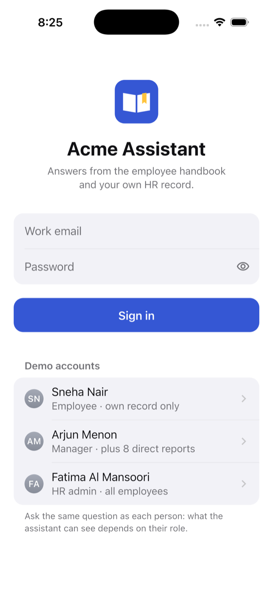
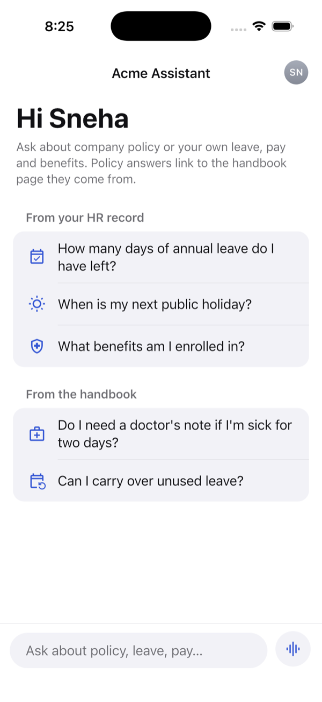
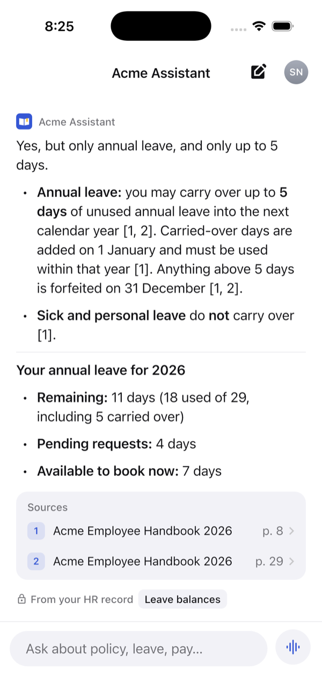
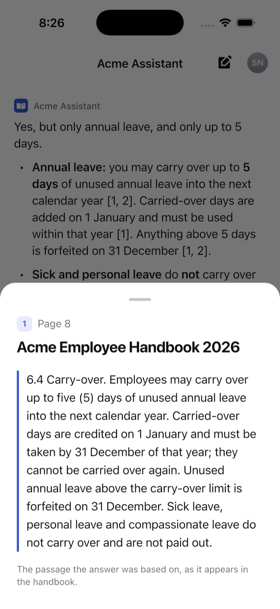
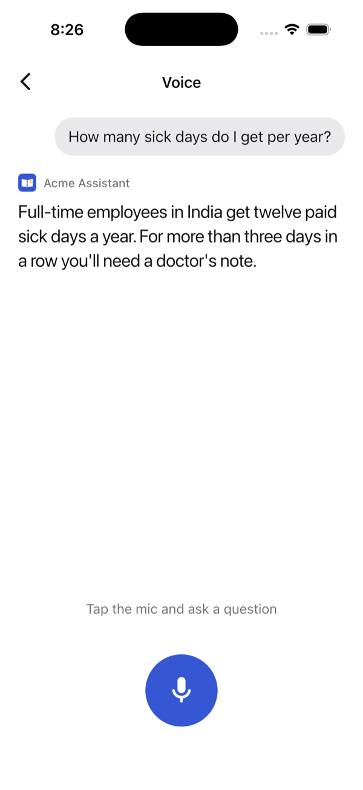
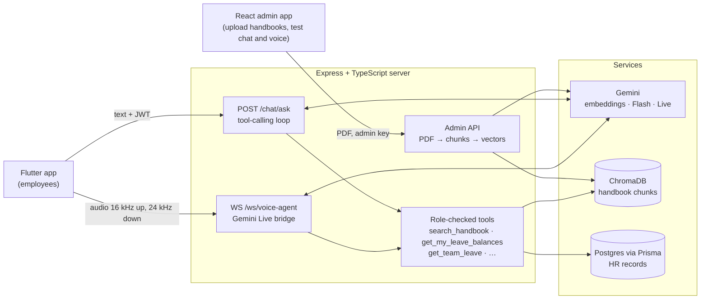

# Acme HR Assistant

An HR assistant that employees can type or talk to. It answers from the company handbook, citing the page, and from the person's own HR records: leave, pay and benefits. The server decides what each role is allowed to see.

<p>
  
  
  
  
  
</p>

Acme is a made-up company. The handbook, the ~130 employees and their HR data are all fictional demo data.

## What it does

- **Answers with sources.** Ask "Can I carry over unused leave?" and the answer quotes the policy with `[1]`-style citations. Tap a citation to read the exact handbook passage and page.
- **Knows who is asking.** The same question uses the person's own records. "How many days of annual leave do I have left?" returns *your* balance, worked out from the database, not a guess.
- **Different roles, different answers.** A manager asking "Which leave requests are waiting for my approval?" sees their team's pending requests. An employee asking the same question is told they have no direct reports, because the tool was never offered to them.
- **Voice.** Push-to-talk conversation through Gemini Live, with spoken answers and live captions. You can interrupt it, and it uses the same tools and access rules as text chat.
- **Fails fast.** If Gemini is overloaded, the server gives up after about 22 seconds with a clear "AI is busy" error, and the app offers Try Again. A demo never hangs.

## Architecture



**Uploading a handbook:** an admin uploads a PDF. A background job splits it into chunks page by page (each chunk keeps its page number), embeds them with `gemini-embedding-001` and stores them in ChromaDB. A new version replaces the old one only once it's fully processed, so a failed upload never leaves the handbook empty.

**Answering a question:** the server gives Gemini the question, the recent conversation and a list of tools the user's role is allowed to use. The model decides what to call:
- `search_handbook` for policy questions
- `get_my_leave_balances`, `get_my_pay`, `get_team_leave` and the other HR tools for personal data

It may call several tools before answering. Text and voice share the same tools, so both get the same answers and the same rules.

## Access control

The app never decides what a user can see. It only sends a login token, and the server enforces access in four layers:

1. **Only allowed tools are offered.** The model never sees tools the role can't use: no `get_team_leave` for an employee, and no HR tools at all without a login.
2. **The role is checked again on every call.** Before a tool runs, the server reads the user's role fresh from the database instead of trusting the token alone.
3. **The model's arguments are validated.** Arguments are checked with zod, and no tool takes an employee ID. Who the user is comes only from the token.
4. **Queries are filtered by role.** The role becomes a filter in the query itself (for example `manager_id = <me>`), so even a correct call can't return someone else's data.

| | Not signed in | Employee | Manager | HR admin |
|---|---|---|---|---|
| Handbook search | ✓ | ✓ | ✓ | ✓ |
| Own profile, leave, holidays, pay, benefits | | ✓ | ✓ | ✓ |
| Team leave | | | direct reports | everyone |
| Colleague directory | | basic details | + details of direct reports | everyone, full details |

The full rules are in [`server/src/auth/permissions.ts`](server/src/auth/permissions.ts).

## Tech stack

| Part | Built with |
|---|---|
| Mobile app | Flutter, Riverpod, `record` (mic), `flutter_pcm_sound` (playback), WebSocket |
| Server | Node 20, TypeScript, Express 5, `ws`, zod, pino |
| AI | Gemini: `gemini-embedding-001`, Flash for text with a fallback model, Gemini Live for voice |
| Data | ChromaDB for vectors; Postgres with Prisma for HR data; JWT login with scrypt-hashed passwords |
| Admin app | React 19, Vite |
| Tests | Vitest for the server (116) and admin app (8); `flutter_test` for the mobile app (29), plus live end-to-end tests on a simulator |

## Repository layout

```
server/    API, ingestion, RAG, voice bridge, HR database   → server/README.md
mobile/    Flutter employee app (chat, sources, voice)       → mobile/README.md
admin/     React admin app: upload handbooks, test chat and voice
docker-compose.yml   ChromaDB and Postgres for local development
```

## Run it locally

You need Node 20+, Docker, Flutter 3.47+ and a [Gemini API key](https://aistudio.google.com/apikey).

```bash
# 1. Databases (ChromaDB on :8000, Postgres on :5433, both bound to localhost)
docker compose up -d

# 2. Server
cd server
npm install
cp .env.example .env          # fill in GEMINI_API_KEY, ADMIN_API_KEY and JWT_SECRET
npx prisma migrate deploy
npm run db:seed               # the fictional Acme employees
npm run dev                   # http://localhost:3000

# 3. Upload the demo handbook (in a second terminal, from server/)
set -a; source .env; set +a
curl -X POST localhost:3000/api/v1/admin/documents -H "x-admin-key: $ADMIN_API_KEY" \
  -F file=@fixtures/acme-employee-handbook.pdf -F docId=acme-employee-handbook \
  -F "title=Acme Employee Handbook 2026"

# 4. Mobile app (iOS simulator or Android emulator)
cd ../mobile
flutter pub get
flutter run

# Optional: the admin app on http://localhost:5173
cd ../admin && npm install && npm run dev
```

Sign in with one of the demo accounts shown on the login screen (password `Password123!`):
- `employee@acme.test`
- `manager@acme.test`
- `hr@acme.test`

The [server README](server/README.md) documents the API, the voice WebSocket protocol and every setting. The [mobile README](mobile/README.md) covers running on a real phone and the live tests.

## Tests

```bash
cd server && npm test         # 116 tests; Gemini, ChromaDB and Postgres are mocked, no keys needed
cd admin && npm test          # 8 tests
cd mobile && flutter test     # 29 unit and widget tests with a fake backend
```

## Limitations

- **HR data is read-only.** The assistant can look up leave but can't submit or approve requests yet.
- **Upload jobs are kept in memory**, so the server is meant to run as a single instance.
- **Scanned PDFs aren't supported.** They would need OCR first.
- **Built for local development:** plain HTTP, local databases. A real deployment would need HTTPS, managed databases and stored jobs.
