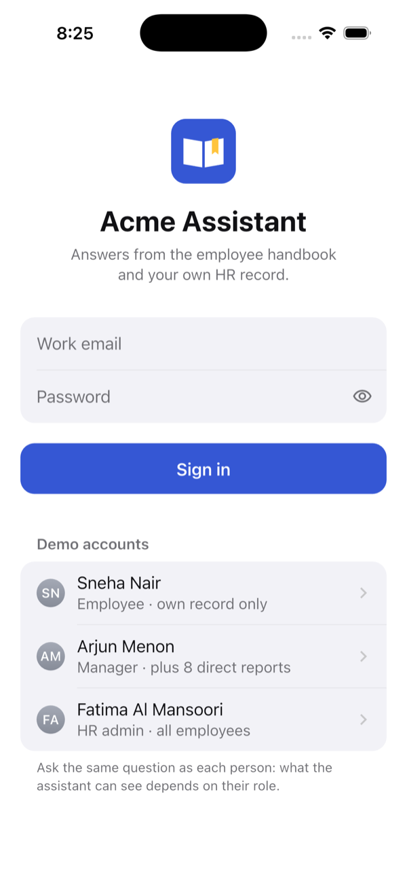
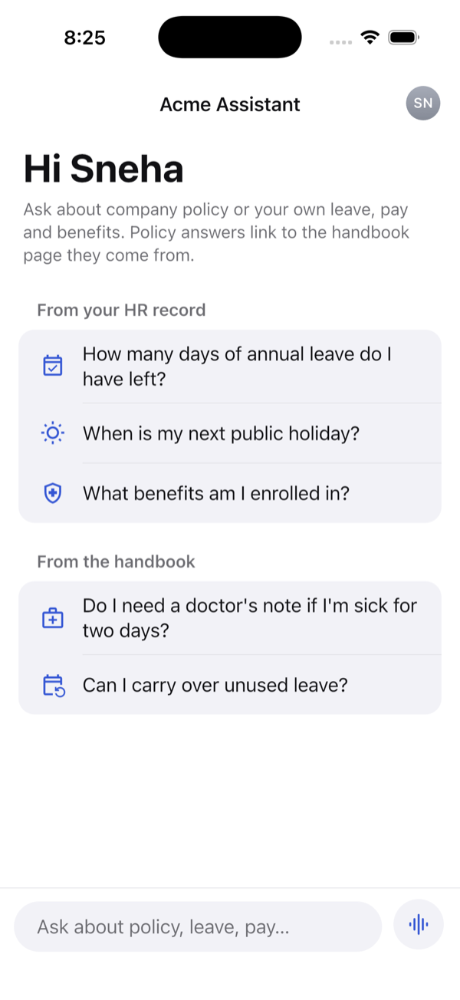
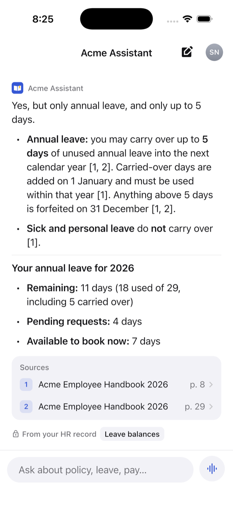
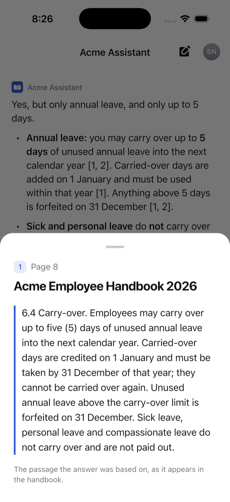
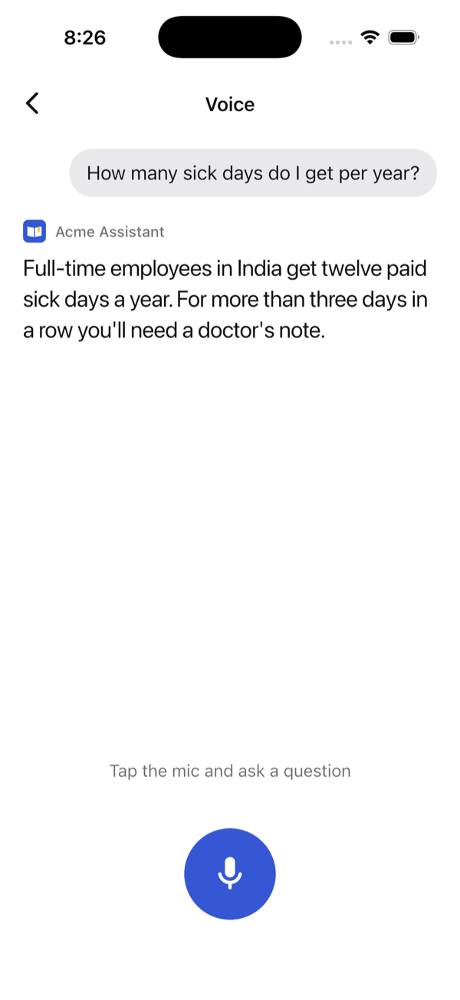

# Acme Assistant (Flutter app)

The employee app for the [handbook RAG server](../server/README.md). Sign in, then ask questions by **text** or **voice**. Answers come from the company handbook (with page citations) and from your own HR records. What you can see depends on your role, and the server enforces it.

| Sign in | Home | Answer with sources | The cited passage | Voice |
|---|---|---|---|---|
|  |  |  |  |  |

Screenshots come from the design preview (see **Tests**). The answers in it are copies of real ones from the server.

## Features

- **Sign in** with email and password, or tap a demo account (employee, manager, HR admin). The token is kept in the iOS Keychain or Android Keystore. A saved session is checked with `GET /me` at startup, and an expired one goes back to login.
- **Text chat** with history for follow-up questions. Answers render as markdown:
  - **Handbook citations** like `[1] p. 8` open the exact passage, so users can check the answer.
  - **HR record chips** (Leave balances, Payslips, Team leave…) show which live data an answer used.
  - **"AI is busy"** (the server's `503 ai_busy`) is shown with a Retry button, so a demo never hangs.
- **Voice**: push-to-talk over a WebSocket to Gemini Live. 16 kHz microphone audio goes up, 24 kHz speech plays back as it streams in, with live captions. Tap the mic while the assistant is speaking to interrupt it.
- **Role-aware suggestions**: managers are offered "Which leave requests are waiting for my approval?"; employees, their own balance and holidays.

## Run it

You need the server running with the HR data seeded and a handbook uploaded (see the [server README](../server/README.md) and [`server/fixtures/acme-handbook`](../server/fixtures/acme-handbook/README.md)).

```bash
flutter pub get
flutter run                 # iOS simulator: talks to localhost:3000
```

- **Android emulator**: works as is (it reaches your Mac at `10.0.2.2:3000`).
- **Real phone**: point it at your Mac's address on the same Wi-Fi:
  ```bash
  flutter run --dart-define=API_BASE_URL=http://192.168.1.20:3000
  ```
- Hide the demo accounts with `--dart-define=DEMO_ACCOUNTS=false`.

Plain `http://` is only allowed for local development: Android debug builds, and local network addresses on iOS. Production needs `https`.

Demo logins (password `Password123!`): `employee@acme.test`, `manager@acme.test`, `hr@acme.test`.

## Tests

```bash
flutter test                # 29 unit and widget tests, fake backend, no server needed
```

Live end-to-end tests drive the real app on a simulator against the real server and Gemini:

```bash
flutter test integration_test/live_chat_test.dart -d <simulator>
flutter test integration_test/live_voice_test.dart -d <simulator> \
  --dart-define=QUESTION_WAV=$PWD/../server/fixtures/question-sick-days.wav
```

To look at every screen without a server or Gemini, run the design preview. It drives the real UI with a pretend backend whose answers are copied from real ones:

```bash
flutter test integration_test/design_preview_test.dart -d <simulator> --dart-define=HOLD_SECONDS=4
```

The voice test replaces the microphone with a recorded question. Everything else (WebSocket, Gemini Live, captions, playback) is real. Add `--dart-define=HOLD_SECONDS=5` to pause on each screen, for screenshots.

## Design

iOS conventions on top of Material, so it feels at home on iPhone and still runs on Android:

- Neutral greys, with one blue for things you can tap. Light and dark mode.
- Apple's text sizes and letter spacing, hairline separators, and inset grouped lists like Settings.
- Answers are set as text to read, not as a bubble. A **Sources** list under each answer names the handbook pages, and a small tag shows which HR records were read.
- The home screen groups suggested questions by where the answer comes from: your HR record or the handbook.
- One round button next to the text field: Voice while it is empty, Send once you type.
- Motion is small (typing dots, a pulsing mic) and stops when Reduce Motion is on.

## Structure

```
lib/
  config.dart              server address, demo-account switch
  api/api_client.dart      JSON + Bearer token; server errors → ApiException
  auth/                    sign-in state (Riverpod AsyncNotifier), token storage, login screen
  chat/                    conversation state, chat screen, answer bubbles and source sheet
  voice/                   WebSocket protocol, mic/speaker/socket interfaces, call state, voice screen
  ui/theme.dart            colours, type scale, grouped lists, the brand mark
```

- State is Riverpod. `authProvider` decides between the login and chat screens. `chatProvider` resets when the user changes. `voiceProvider` lives only while the voice screen is open: leaving it hangs up and releases the mic.
- The socket, microphone and speaker sit behind small interfaces (`voice/voice_io.dart`), so tests run the call logic with fakes.
- The app never decides what a user may see. It sends the token, and the server filters every answer by role.

## App icon

An open handbook with a bookmark, drawn with plain shapes by `tool/draw_icon.swift` (the in-app `BrandMark` paints the same shapes), then sized for each platform:

```bash
swift tool/draw_icon.swift "$PWD/assets/icon" && dart run flutter_launcher_icons
```
